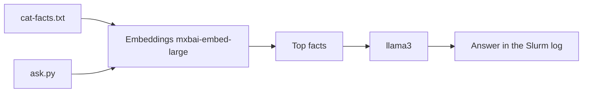

# SLAIF Labs: RAG on HPC (Apptainer & Slurm)

## Portable retrieval-augmented generation for AI & HPC

This repository is a hands-on workshop for running a small Retrieval-Augmented Generation (RAG) pipeline on an HPC cluster. The pipeline reads a local knowledge base, retrieves the relevant lines, and asks a local Ollama model to answer from those lines only.

It follows the same lab shape as [hpc-apptainer-workshop](https://github.com/rpritr/hpc-apptainer-workshop): three short labs, each with a goal, commands, and a checkpoint.

---

## Goal

By the end of the session, participants can:

- explain a RAG pipeline as retrieve, then generate
- package that pipeline in an Apptainer image
- submit it as a GPU batch job with Slurm
- read the job logs and change the question

---

## Who this is for

Participants who can use a Linux shell and who have completed the Apptainer labs, or who already know `apptainer exec`, a `.def` file, and `sbatch`.

The earlier workshop covers containers on their own. This one puts a real AI workload inside them.

---

## Schedule

About 3 hours, including one build and one queue wait.

| Time | Block | What happens |
|------|--------|----------------|
| 0:00 | Opening | RAG in one picture, the five files, where we will run them |
| 0:20 | [Lab 01](./lab01/README.md) | Read the knowledge base, `rag.py`, and `ask.py` |
| 0:50 | [Lab 02](./lab02/README.md) | Build `rag_environment.sif` and smoke-test Python |
| 1:35 | Break | The image build is the natural break if it is still running |
| 1:50 | [Lab 03](./lab03/README.md) | Submit the GPU job, watch the queue, read the answer |
| 2:35 | Second question | Change `query` in `ask.py` and submit again |
| 2:50 | Close | Reflection questions |

Facilitation notes, the pre-flight checklist, and what to do when the room gets stuck are in [INSTRUCTOR.md](./INSTRUCTOR.md). Speaker notes for the opening are in [slides/OUTLINE.md](./slides/OUTLINE.md).

---

## Labs

| Lab | Title | Participants leave able to |
|-----|--------|----------------------------|
| [Lab 01](./lab01/README.md) | The RAG pipeline | Point at the fact file, the retrieval step, and the generation step |
| [Lab 02](./lab02/README.md) | The Apptainer image | Build the image and show that Python can import `ollama` and `numpy` |
| [Lab 03](./lab03/README.md) | The Slurm GPU job | Submit the job, find the answer in the log, and ask a second question |

---

## The working directory

All commands in the labs run from `RAG/`. That directory is what you copy to the cluster.

| File | Role |
|------|------|
| `cat-facts.txt` | Knowledge base. One fact per line. |
| `rag.py` | Load facts, embed them, retrieve the closest lines, call the LLM |
| `ask.py` | The question for a non-interactive batch run |
| `rag_environment.def` | Recipe for the container image |
| `run_rag.sh` | Slurm script: start Ollama, pull models, run `ask.py` |



---

## Before the session

On the cluster login node:

```bash
git clone https://github.com/rpritr/hpc-rag-ai-workshop.git
cd hpc-rag-ai-workshop/RAG
bash check_layout.sh
apptainer --version
sbatch --version
sinfo
```

`sinfo` must show the partition named in `run_rag.sh` (`compute` in the script as shipped). Change that line if the GPU partition has another name.

A full dry run by the instructor, the day before, is part of the workshop. See [INSTRUCTOR.md](./INSTRUCTOR.md).

---

## Project layout

```text
README.md                 this page
INSTRUCTOR.md             how to lead the session
slides/OUTLINE.md         opening talk track
lab01/README.md           pipeline walkthrough
lab02/README.md           container build
lab03/README.md           Slurm job
RAG/                      files that go to the cluster
sources/                  original module handout
```

---

## Series

Part of the SLAIF labs, after [Apptainer (Singularity)](https://github.com/rpritr/hpc-apptainer-workshop).
